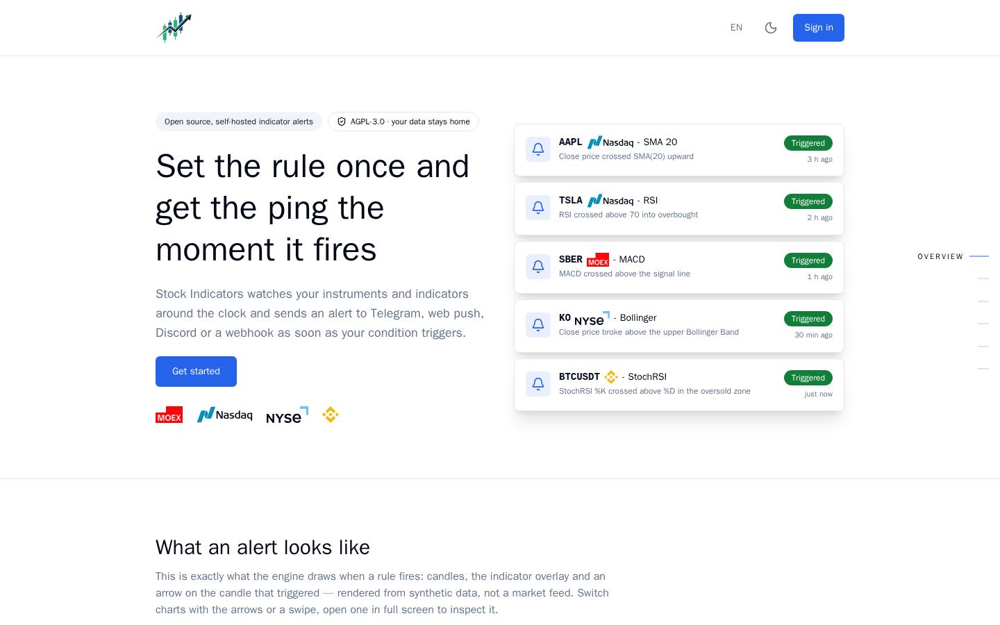
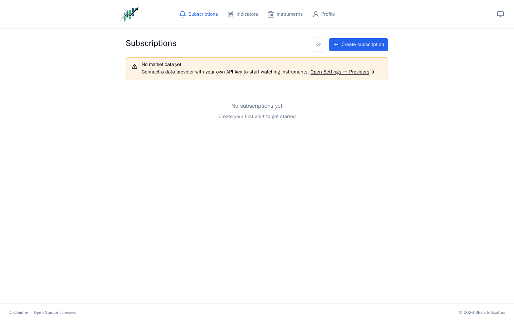
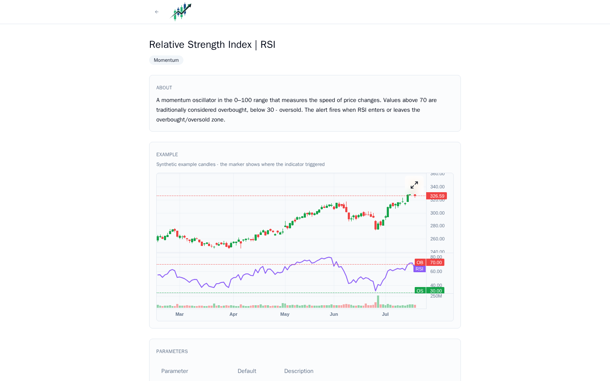
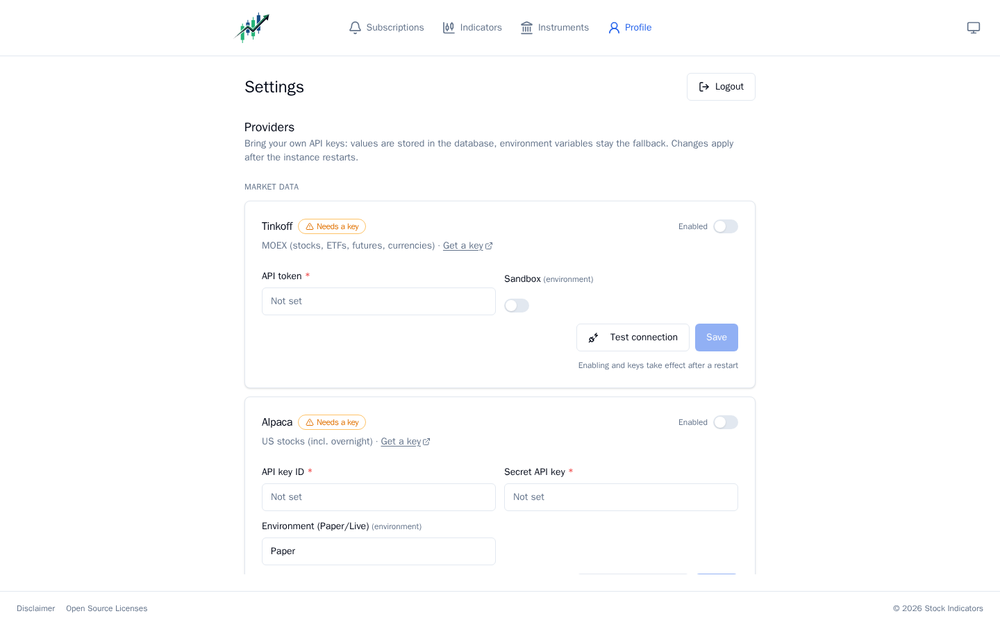

# Stock Indicators

Self-hosted technical-indicator monitoring for your own trading instruments: combine indicators
into rule trees, subscribe a rule to an instrument and time frame, and get a notification the
moment the condition fires — with the chart fragment that triggered it.

One installation, one user, your machine. **No accounts, no billing, no telemetry, no third-party
server is required to run it** — and no market data is shipped: you connect your own providers
with your own API keys (BYOK), and everything is stored in your own database.



## Install with Docker

```bash
git clone https://github.com/Drenalol/StockIndicators && cd StockIndicators/packaging
cp .env.example .env          # then set SI_PASSWORD (and POSTGRES_PASSWORD)
docker compose up -d
```

Open http://localhost:8080, sign in with the password, and connect your data providers under
**Settings → Providers** (each has a connection test; enabling applies after a restart).

That single image serves the frontend and the API from one origin, runs the alert scheduler, and
renders alert chart images with a built-in headless Chromium. Redis (a second-level candle cache)
is optional: `docker compose --profile redis up -d`.

A fresh instance tells you exactly what it still needs:



## What it does

- **Indicators** — 35 of them: moving averages (SMA, EMA, WMA, HMA, KAMA, VWMA), RSI, MACD,
  Bollinger Bands, Stochastic and StochRSI, ADX, ATR, CCI, CMO, Chandelier Exit, Donchian,
  Keltner, Ichimoku, MFI, OBV, PSAR, SuperTrend, Trailing Stop, TSI, VWAP, Vortex, Williams %R,
  gap / round-price / 52-week-high-low detectors, volume and price change.
- **Rules** — an AND/OR tree of conditions over one or more indicators of one or more instruments,
  with ready-made presets for the common shapes.
- **Subscriptions** — a rule bound to an instrument and time frame, with a cooldown, trading-session
  awareness (MOEX and US sessions with holidays, pre/post/overnight) and an unread history.
- **Trigger history with charts** — every alert keeps the candle it saw and the detection moment;
  the notification carries a rendered chart image with the marker on the candle that fired.
- **Notification channels** — Telegram (a full bot with forms, in nine languages), Web Push,
  Discord, WhatsApp, SMTP email and a generic webhook; per-subscription templates with variables.
- **Live UI** — the chart of an open subscription updates over SignalR as candles arrive.
- **Nine interface languages** — en, ru, be, uk, de, es, fr, it, pt-BR.

The public indicator pages document every indicator with an example chart (synthetic data) and
one-tap rule presets — and they work before you ever sign in:



## Bring your own data

| Source | What it gives |
|---|---|
| [Tinkoff Invest API](https://tinkoff.github.io/investAPI/) | Russian market instruments and candles |
| [Alpaca](https://docs.alpaca.markets/us/docs/trading-api) | US equities, paper or live keys (Trading API is enough) |
| [Binance](https://developers.binance.com) | crypto candles |
| [BusinessQuant](https://www.businessquant.com) | EOD and intraday for US/global equities |
| [Yahoo Finance](https://finance.yahoo.com) (enricher) | instrument names, sectors, descriptions |

Keys go into the database via **Settings → Providers** (environment variables stay a fallback);
every card has a connection test before you store anything.



Each provider's own terms decide what you may do with the data you pull with your own key — read
[docs/DATA_SOURCES.md](docs/DATA_SOURCES.md) before exposing an instance to other people.

## Requirements

- Docker (the compose stack) — or the .NET 10 SDK and Node 22+ to run from source.
- PostgreSQL 14+ (the primary store; the compose file brings its own).
- Redis is optional: a second-level cache for candles and logos, the app runs without it.

## Running from source

```bash
# 1. backend (migrations run on startup; needs a Postgres — see src/StockIndicators.API/README.md)
cd src
ConnectionStrings__CandleStorage="Host=127.0.0.1;Port=5432;Database=stock_indicators;Username=postgres;Password=postgres" \
LocalAuth__Password=dev-password \
dotnet run --project StockIndicators.API     # https://localhost:5051

# 2. frontend (proxies /api to the backend)
cd ../web
npm install && npm run dev                   # http://localhost:5173
```

Open http://localhost:5173, add your provider keys under Settings → Providers, restart the backend,
and create your first rule.

## Configuration

Every setting is a section in `src/StockIndicators.API/appsettings.json`, overridable by
environment variables with the same path (`Section__Key`). The ones you will actually touch:

| Variable | Meaning |
|---|---|
| `ConnectionStrings__CandleStorage` | PostgreSQL connection string (required) |
| `LocalAuth__Password` / `LocalAuth__PasswordHash` | the sign-in password; a PBKDF2 digest is made with `dotnet run --project src/StockIndicators.API -- hash-password` |
| `RedisConfiguration__Hosts__0__Host` | redis host; leave unset to run without redis |
| `TelegramBotOptions__Token` / `BotLink` / `IncludeWebLinks` / `InstanceUrl` | your own bot, created with @BotFather (or stored via Settings → Providers) |
| `AlertOptions__PublicBaseUrl` | base URL used in links inside notifications |
| `Frontend__Origins` | extra origins for CORS and the CSRF origin guard; empty for a single-origin install |
| `Metrics__Enabled` | expose the Prometheus `/metrics` endpoint (off by default) |
| `PublicSite__LandingOnly` | publish the marketing surface only (see below); off by default |

Provider API keys are managed in the app (Settings → Providers) and stored in the database;
changes apply after a restart. The full reference lives in
[src/StockIndicators.API/README.md](src/StockIndicators.API/README.md).

The bot links to the instance only when you turn that on (`TelegramBotOptions__IncludeWebLinks`,
off by default); with it off, bot messages and alerts carry no links at all. With it on, the
addresses they point at (`TelegramBotOptions__InstanceUrl`, `AlertOptions__PublicBaseUrl`) have to
be reachable from outside your network: Telegram checks every link button URL on its own servers
and refuses `localhost` and LAN names outright, so an install behind a domain or a tunnel puts
that public base URL in both. The providers page warns about it while the value is still just
typed in.

To publish only the public pages - the landing, the indicator catalog with its example charts and
presets, the legal pages and the link-preview pictures - start the same image with
`PublicSite__LandingOnly=true`. The application part is then never wired: there is no sign-in, no
dashboard, no database, no provider and no alert scheduler, and everything outside those pages
answers 404. The frontend reads the mode from `/api/site/config` and points its calls to action at
the installation instead of a login. This is how the project's own site is served; your own
instance keeps the flag off.

## Repository layout

```
src/          .NET solution: API, Application, Domain, Infrastructure, provider projects
web/          React + Vite frontend (PWA), the chart renderer and the static SEO pages
packaging/    docker-compose, .env.example
Dockerfile    single image: frontend build + backend + headless Chromium for alert images
docs/         DATA_SOURCES.md and friends
```

## Development

```bash
cd src && dotnet build && dotnet test          # backend, xUnit
cd web && npm run lint && npm run typecheck && npm run check:i18n
```

Interface texts live in `web/src/i18n/<locale>.json` and all nine locales must move together —
`npm run check:i18n` fails the build on a missing or stale key.

## License and disclaimer

AGPL-3.0 — see [LICENSE](LICENSE) and [THIRD-PARTY-NOTICES.md](THIRD-PARTY-NOTICES.md). The
application comes with absolutely no warranty; nothing in it is investment advice, and no
indicator described here predicts anything.
